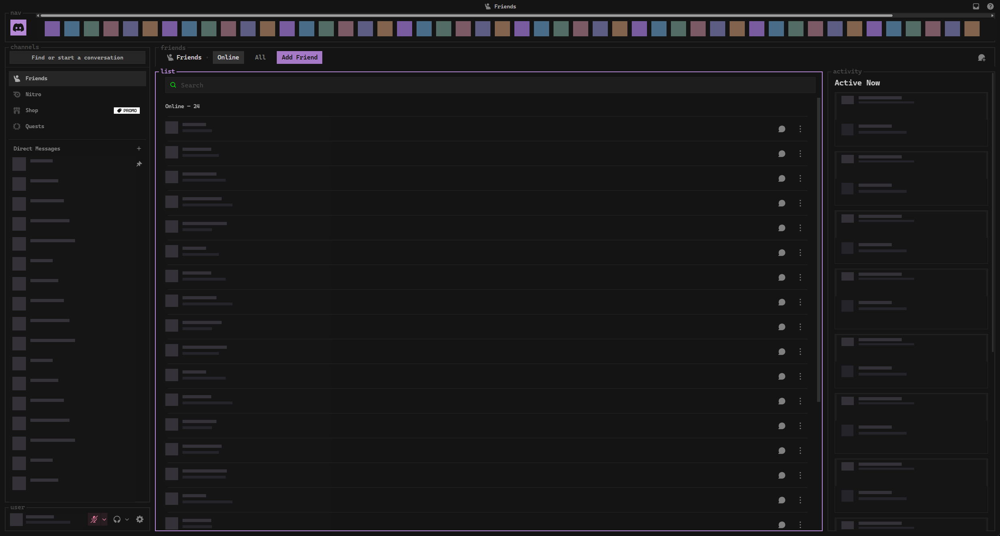

# Discord system24 + Vertical Servers (Theme For Browser)

A standalone Chrome / Edge extension for Discord web, adapted from refact0r's original MIT-licensed system24 theme. Matches the supplied reference's neutral dark surfaces, purple accents, monospace text, square avatars and controls, and labeled panel borders. The horizontal server bar uses Discord's current native web grid.

## Install

1. Open your local checkout, or download and extract the repository ZIP from GitHub (**Code → Download ZIP**).
2. Open `chrome://extensions` or `edge://extensions`.
3. Enable **Developer mode**, click **Load unpacked**, and select the [`extension/`](extension/) folder containing `manifest.json`.
4. Refresh your Discord web tab.

No Vencord, BetterDiscord, or desktop client modification is required.

Click the extension icon to change the accent (purple, green, cyan, red), switch the server list between top and left, toggle panel labels or hover text glow, and adjust text size, panel spacing, and border thickness. Preferences save on this device and apply to open Discord tabs. Scroll over the top bar with a mouse or trackpad to reach more servers. The pinned purple Discord logo opens `/channels/@me` (Friends), including from a server or DM. Reset appearance restores the reference defaults.

## Repository layout

- [`extension/`](extension/) contains the browser extension, including the theme, navigation, and settings popup.
- [`scripts/`](scripts/) contains the local verification script.
- [`THIRD_PARTY.md`](THIRD_PARTY.md) and [`licenses/`](licenses/) contain source credits and licenses.

## Scope and privacy

The extension runs only on `https://discord.com/*`, and activates styling only on `/channels` routes. Login, registration, marketing, and developer pages are excluded from styling. The only permission is `storage`; there is no background process, account API access, message reading, analytics, remote script, font download, or extension network request. Existing Discord media and functions remain native.

The theme uses locally installed DM Mono, Cascadia Mono, Consolas, Courier New, or a monospace fallback. Desktop plugin panels in the reference, including the Spotify player, game detection panels, custom window buttons, and plugin read counters, are not added by this browser theme. Browser tabs and bookmarks are outside its scope. The only added navigation element is the pinned Home link; server controls and their order remain native.

Disable **Theme enabled** to remove the root styling gate immediately. All visual selectors are gated; registered custom properties are namespaced. Uninstalling and refreshing also restores the normal web appearance.

## Verification and limits

Local checks cover manifest resources and permissions, JavaScript syntax, valid settings, storage updates, disabling, delayed-startup races, route exclusions, CSS parsing and selector scoping, and the absence of remote stylesheet resources. The layout selectors were checked against Discord's public web CSS downloaded on 2026-10-31.

Version 1.0.1 addresses the vertical server-icon jumps shown in the user's recording. The server scroller now retains native vertical coordinates inside a rotated viewport, preserving Discord's focus/scroll-into-view and folder layout. The surrounding frame and pinned Home button remain upright. Mouse wheel and horizontal trackpad motion both scroll the list; Ctrl + wheel retains browser zoom. Native vertical NEW overlays are hidden in horizontal mode so they cannot cover server icons; per-server unread and mention badges remain. Regression checks cover Home mounting, replacement, disabling, and wheel handling.

Signed-in appearance, expanded server folders, live calls, sharing/fullscreen, and narrow-window layouts have not been visually verified. Browser preview access was unavailable in this session. Discord can change its markup and may require a selector update. Other Discord theme extensions can conflict; use one appearance theme at a time.

Run `node scripts/verify.mjs` from the repository root for the bundled local checks. Independent extension, unaffiliated with Discord or the original theme authors.

## License

Original contributions to this extension are available under the [MIT License](LICENSE). See [THIRD_PARTY.md](THIRD_PARTY.md) and [licenses/](licenses/) for upstream credits and license notices.
